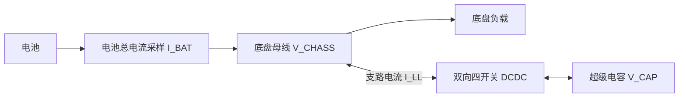
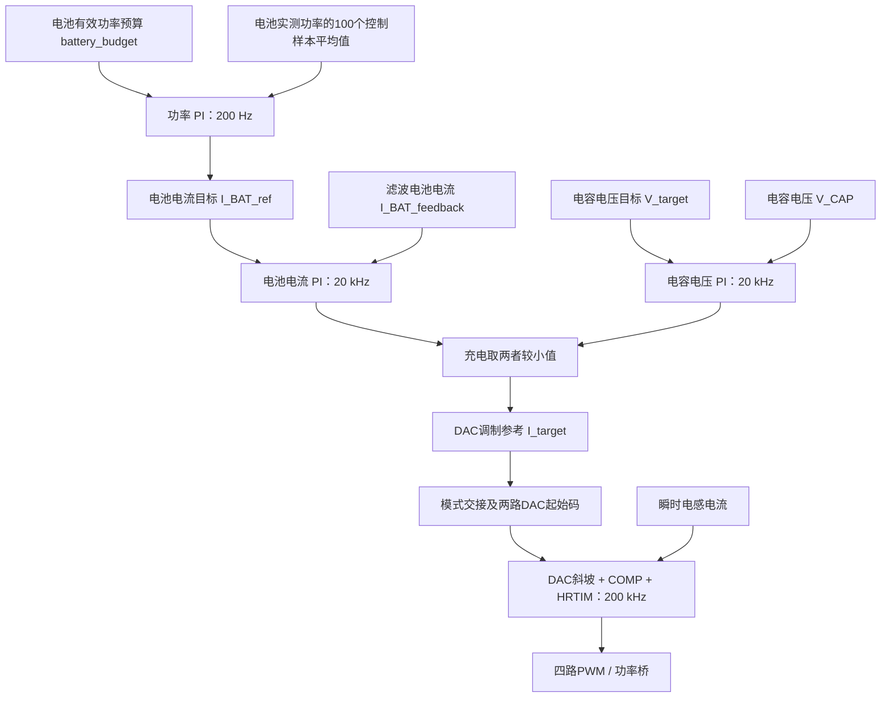
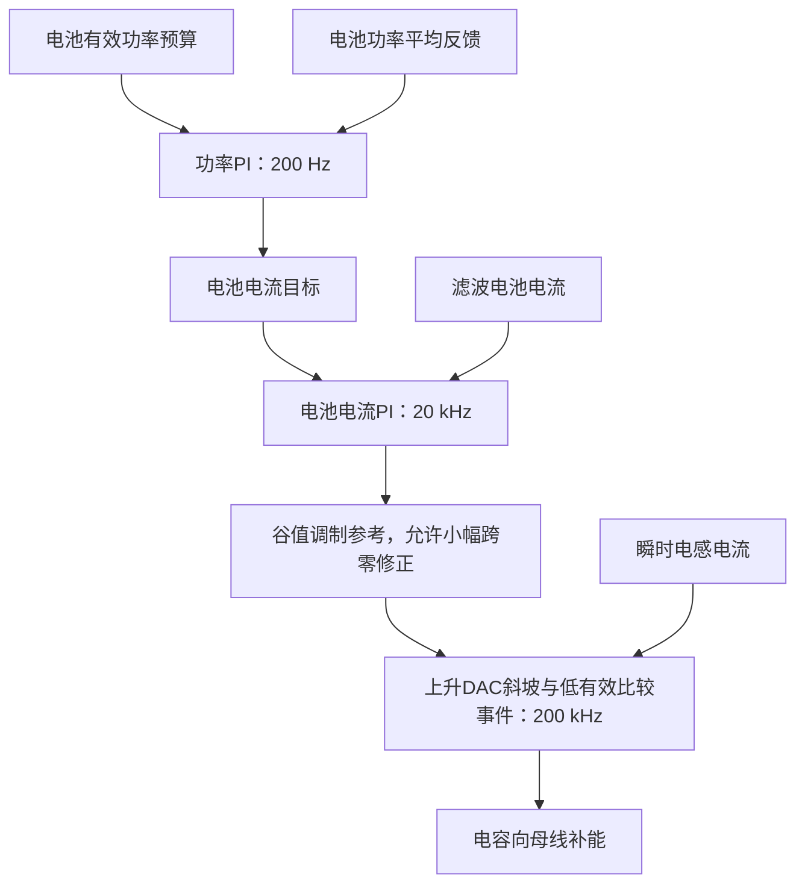
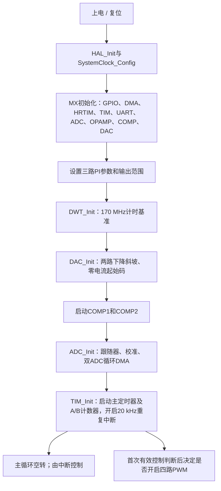
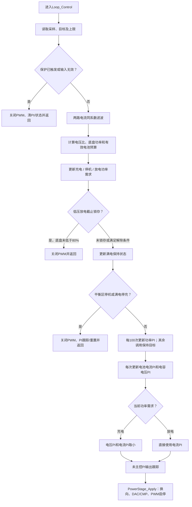

# 超级电容系统代码流程与控制详解

说明日期：2026-11-15。本文依据当前工作区的实际代码，主要对应 `User/task.c`、`User/task.h`、`Core/Src/main.c` 和 ADC、DAC、COMP、HRTIM 配置。

**当前参数快照：电容目标 28 V，电池功率目标 60 W，电池电流上限 5 A，Buck 斜坡步长 200，Boost 斜坡步长 180。** 这里采用当前文件中的 200，不沿用之前修改记录里的 360。

本文解释已经实现的逻辑。流程中的电压、电流、功率示例，除明确说明外均为忽略损耗后的计算示例，不是新的实物测试结果。程序以后修改时，应以代码为准。

## 1. 先理解整套系统要完成什么

电池连接底盘母线，底盘和双向 DCDC 的母线侧并联，DCDC 的另一侧连接超级电容。



系统根据底盘实际需求，决定电容吸收能量还是释放能量：

| 情况 | 希望电容做什么 | 稳态下的功率关系 |
|---|---|---|
| 底盘功率明显低于电池预算，电容还没充满 | 吸收剩余功率、充电 | 电池供底盘，也供电容 |
| 底盘功率明显高于电池预算，电容高于放电截止电压 | 补足底盘缺少的功率 | 电池供预算内部分，电容补差额 |
| 底盘功率处于预算附近的迟滞区 | 停充停放，减少反复换向 | 电池主要供应底盘 |
| 电容充满，而底盘未超预算 | 保持停充 | 电池功率可以低于预算 |
| 电容放到 10 V，底盘仍超预算 | 锁住 DCDC 的 PWM | 电容不再主动补能，电池可能超过预算 |

“电池恒功率”有工作条件：只有电容允许充放电、变换器调节能力足够时，才有条件把电池功率调到预算附近。满电、低压截止、平衡区停机等状态会主动让出这个目标。

### 1.1 电流方向约定

| 量 | 正方向 | 负方向 |
|---|---|---|
| `adc_data.current.I_BAT` | 电池向底盘母线供电 | 母线向电池回流 |
| `adc_data.current.I_LL` | 母线流入 DCDC，通常对应电容充电 | DCDC 向母线送电，通常对应电容放电 |
| 瞬时电感电流 `I_L` | 电池侧 A 桥流向电容侧 B 桥 | 电容侧 B 桥流向电池侧 A 桥 |

`I_LL` 是 DCDC 母线侧支路电流；COMP1、COMP2 接的是你已确认的瞬时电感电流信号。这两者用途不同，不能混为一条采样。

### 1.2 必须区分的三个“电流”

| 名称 | 代码中的位置 | 含义 |
|---|---|---|
| 电池电流目标 | `loop_var.I_BAT_ref` | 功率外环希望电池提供的总电流 |
| 电流调制参考 | `loop_var.I_target` | 软件环路交给 DAC 调制层的参考，含斜坡和纹波相关偏置 |
| 电容端实际平均电流 | 当前主控制中没有独立的该变量或该反馈环 | 受电压比、功率、效率和电感波形共同影响 |

例如：电池 24 V、功率 60 W，对应电池电流约 2.5 A；若底盘用 10 W，剩余约 50 W 可用于充电。电容是 20 V 时，理想电容充电电流约 2.5 A；电容是 10 V 时则约 5 A。

因此，`I_BAT_ref`、`I_target`、电容平均电流三者通常不相等。当前 15 A 宏限制的是调制参考及相应的 DAC 计算范围，不能把它理解为已经实现了独立的“电容端平均电流严格限流 15 A”。

## 2. 控制架构：谁管功率，谁管电压，谁决定每个脉冲

充电时的控制结构是：**功率外环产生电池电流目标，电池电流 PI 与电容电压 PI 竞争，最后由比较器完成逐周期峰值调制。**



这不是让功率 PI、电压 PI、电流 PI 的三个输出一起取最小值。功率 PI 输出的是“电池电流目标”；另外两路 PI 才输出同一层级的“DAC 调制参考”。

放电时：



放电时电容电压 PI 不参加最终取小竞争。电容电压主要用于模式判断、10 V 放电截止和全局 30 V 上限判断。

### 2.1 三种更新速度

| 层级 | 当前频率 | 周期 | 完成的事情 |
|---|---|---|---|
| HRTIM、DAC 斜坡、比较器逐周期调制 | 200 kHz | 5 μs | 每个开关周期内决定脉冲何时结束 |
| ADC 硬件触发 | 名义 200 kHz | 5 μs | A 定时器 CMP3 触发一组双 ADC 序列，DMA 更新内存 |
| 软件 `ADC_Convert()` / `Loop_Control()` | 20 kHz | 50 μs | 物理量换算、状态判断、电流/电压 PI、更新调制参考 |
| 功率 PI | 200 Hz | 5 ms | 使用 100 个软件控制样本的功率平均值更新电池电流目标 |

200 kHz 是硬件开关频率；20 kHz 是软件控制更新频率；200 Hz 是功率 PI 的调用频率。**调用频率不等于环路带宽，也不等于系统在该时间内一定完成稳态调节。**

## 3. 文件分工与实际调用链

| 文件 | 实际职责 |
|---|---|
| `Core/Src/main.c` | 初始化时钟和外设、设置 PI 参数、启动采样和控制，提供 HRTIM 回调 |
| `Core/Src/stm32g4xx_it.c` | HRTIM、DMA、SysTick 等中断入口 |
| `User/task.c` | ADC 解包换算、PI、功率管理、充放电切换、模式交接、DAC/PWM 执行 |
| `User/task.h` | 当前控制参数、数据结构、枚举、寄存器简写 |
| `Core/Src/hrtim.c` | A/B 定时器时序、外部比较器事件、ADC/DAC 触发、互补死区 |
| `Core/Src/adc.c` | 双 ADC 同步转换、通道顺序、循环 DMA |
| `Core/Src/comp.c` | COMP1/2 的电流比较输入及 DAC 阈值输入 |
| `Core/Src/dac.c` | DAC1 两个通道、HRTIM 复位/步进触发、初始锯齿配置 |
| `Core/Src/opamp.c` | 电池母线电压、电容电压的片内跟随器配置 |
| `User/loop.c` / `loop.h` | 保留的 3P3Z 实现；当前正式控制链未调用 |
| `User/vofa.c` | 保留的串口波形发送工具；当前主循环和控制回调未主动调用 |
| `User/ws2812.c` | 保留的灯驱动；当前 `WS2812_Init()` 被注释 |

运行中的核心调用链：

```text
HRTIM主定时器重复事件
  → HRTIM1_Master_IRQHandler()
  → HAL_HRTIM_IRQHandler(...MASTER)
  → HAL_HRTIM_RepetitionEventCallback()
  → ADC_Convert()
  → Loop_Control()
  → PowerStage_Apply()
      ├─ 必要时：PowerStage_Stop() → PowerStage_SetDirection()
      ├─ 充电：Charge_ApplyPeak()
      └─ 放电：Discharge_ApplyValley()
  → 写DAC STR1/STR2和定时器CMP1
  → 硬件根据电流比较事件产生PWM
```

主循环 `while (1)` 目前为空。控制并不是在主循环里反复执行，也没有使用 RTOS 任务；主要工作在 HRTIM 中断回调里完成。

## 4. 上电初始化的完整过程



### 4.1 PI 的初始参数

| PI | `K_p` | `K_i` | 主要输出 |
|---|---|---|---|
| `PI_Volt_Controller` | 0.05 | 0.0005 | 充电 DAC 参考上限 |
| `PI_Current_Controller` | 0.02 | 0.0055 | 充电/放电 DAC 参考 |
| `PI_Power_Controller` | 0.01 | 0.0055 | 电池总电流目标 |

三路 PI 的 `K_i` 是离散调用中的积分系数。代码里没有再显式乘 `dt`；因此不能把这些数直接当成连续域积分增益。如果改变调用频率，同一组数字对应的动态行为也会改变。

### 4.2 `DAC_Init()`

初始化设置两路均为下降锯齿：

```text
DAC1 CH1：零电流起始码 2048，步长参数 200。
DAC1 CH2：零电流起始码 2048，步长参数 180。
```

后续真正换向时，`PowerStage_SetDirection()` 会重写斜坡方向和步长，所以不能只看 CubeMX 的初始锯齿配置来判断当前正在充电还是放电。

### 4.3 `ADC_Init()`

按实际代码依次执行：启动 OPAMP6/OPAMP2 → 校准 ADC1/ADC2 → 启动双 ADC DMA → 禁止 DMA 半传输/全传输中断 → 启动 ADC2。

禁用 DMA 的 HT/TC 中断，不会停止 DMA 搬运。DMA 仍持续更新数据，只是不再每次搬运都让 CPU 进入回调。

### 4.4 `TIM_Init()`

先把 A 的 CMP1 设为 24480，把 B 的 CMP1 设为 2720；软件更新一次寄存器；再设置主定时器重复计数器：

```c
MREP = CONTROL_LOOP_DIVIDER - 1U;  // 10 - 1 = 9
```

这样每 10 个 200 kHz 开关周期产生一次软件控制重复事件，也就是 20 kHz。

此时启动的是计数器。四路功率 PWM 要由后续 `PowerStage_Apply()` 根据有效采样、工作状态和参考值决定是否打开。

## 5. ADC 数据如何变成电压、电流和功率

### 5.1 数据来自哪里

ADC1 是双 ADC 模式的主 ADC，ADC2 为同步配合的 ADC。ADC1 的外部触发源为 `HRTIM_TRG1`，这个触发来自 A 定时器 CMP3。

当前 A 的 CMP3 = 2720，占周期 10%，名义上位于 A 周期开始后 0.5 μs。每次触发，两个 ADC 各完成两个规则通道的序列；同一 rank 的 ADC1、ADC2 结果打包到一个 32 位 DMA 数据里。

| DMA 数据 | 低 16 位：ADC1 | 高 16 位：ADC2 |
|---|---|---|
| `adc_data_raw[0]` | rank1：`I_BAT`，ADC1_IN11 / PB12 | rank1：`I_LL`，ADC2_IN15 / PB15 |
| `adc_data_raw[1]` | rank2：`V_CHASS`，ADC1_IN14 / PB11 | rank2：`V_CAP`，ADC2_IN3 / PA6 |

`ADC_Convert()` 解包后对应：

```text
adc_data_mid[0] = 电池电流原始码
adc_data_mid[1] = 底盘母线电压原始码
adc_data_mid[2] = DCDC支路电流原始码
adc_data_mid[3] = 电容电压原始码
```

ADC/DMA 在硬件中运行，20 kHz 的软件回调读取当时内存里的结果。它不是每次回调才启动一次 ADC，也没有把连续 10 个 PWM 周期的 ADC 值逐一求平均。

### 5.2 电压换算

两路电压的基本公式相同：

```text
引脚电压 = 原始码 / 4095 × 3.3 V
实际电压 = k × 引脚电压 × 16 + b
```

当前电压系数都是 `k=1、b=0`，对应 16 倍还原分压。理论满量程为 52.8 V，单码约 12.9 mV；实际误差还受参考电压、分压和模拟链影响。

### 5.3 电流换算

5 mΩ 采样电阻、20 倍放大，对应：

```text
每 1 A → 采样电阻压差 5 mV → 放大后变化 100 mV。
理想 0 A → 放大信号约 1.65 V。
未校准电流 = (引脚电压 - 1.65) / 0.1。
```

当前软件还做了校准，实际表达式为：

```text
I_BAT = -(1.081356 × 未校准电流 + 1.111327)
I_LL  =   1.007915 × 未校准电流 + 0.087894
```

电池电流公式外面的负号，是采样方向换算的一部分，不能因为看见负号就认为程序把“放电电流”算错了。判断应以最终量的方向约定为准。

### 5.4 三个功率变量

```text
P_BAT   = V_CHASS × I_BAT
P_LL    = V_CHASS × I_LL
P_CHASS = V_CHASS × (I_BAT - I_LL)
```

由此可得代码中的代数关系：

```text
P_BAT = P_CHASS + P_LL
```

充电时 `P_LL>0`；放电时通常 `P_LL<0`。

例如电池 60 W、底盘 70 W，应该看到 `P_LL≈-10 W`。这表示 DCDC 向母线补约 10 W；电容端实际释放的功率还要覆盖 DCDC 损耗，通常会稍大于 10 W。

三个功率显示量使用原始换算后的电流，而控制中的部分判断使用滤波电流。两者短时读数不完全一致是代码本身的安排。

## 6. `Loop_Control()` 一次调用的完整流程

每 50 μs 执行一次，下图是实际执行顺序：



### 6.1 先形成三个局部目标

```text
voltage_target = Clamp(loop_var.V_target, 0, 30)
current_limit  = Clamp(loop_var.I_BAT_target, 0, 15)
power_target   = loop_var.P_BAT_target
```

其中 `current_limit` 是电池电流目标的上限，不是电容电流反馈上限。默认值为 5 A。

### 6.2 无效输入和保护优先

电容电压达到或超过 30 V，会置 `protect_flag=true`。保护标志已置位，或输入/目标不满足代码要求，程序立即停止 PWM，清理 PI 和初始化状态后返回。

这条路径优先于所有功率调节，不会先把剩余控制计算做完再停机。

### 6.3 两路电流滤波

首次有效调用直接用实测值初始化，后续每次执行：

```c
I_BAT_feedback += 0.25f * (I_BAT - I_BAT_feedback);
I_LL_feedback  += 0.25f * (I_LL  - I_LL_feedback);
```

可理解为：每次吸收新旧差值的 25%，削弱采样尖峰对 PI 和功率判向的影响。20 kHz 下等效一阶时间尺度约 0.15～0.17 ms；这是反馈平滑引入的延迟，不是所有动作统一等待这么久。

两条电流用同一系数，便于相减求底盘电流时保持相近的动态延迟。

### 6.4 底盘功率和有效预算

```text
chassis_power = vin × (I_BAT_feedback - I_LL_feedback)
battery_budget = min(P_BAT_target, vin × current_limit)
```

预算同时考虑功率设定和电池电流限制。例如：24 V、60 W、5 A 时，预算为 `min(60,120)=60 W`；若把电池电流限制设成 2 A，预算就变成 `min(60,48)=48 W`。

功率状态判定和功率 PI 都使用这个有效预算，不会在 2 A 限流时还无休止地要求 60 W。

## 7. 功率迟滞：为什么 60 W 附近不再来回切充放电

由 `PowerStage_UpdatePowerRequest()` 完成，定义：

```text
surplus = battery_budget - chassis_power
enter   = min(2 W, battery_budget × 5%)
exit    = enter × 25%
```

默认预算 60 W 时，`enter=2 W`，`exit=0.5 W`。

| 原状态 | 底盘功率条件 | 新状态 |
|---|---|---|
| 停充停放 | ≤58 W | 开始充电需求 |
| 停充停放 | ≥62 W | 开始放电需求 |
| 充电需求 | 升到 ≥59.5 W，但未直接跨入放电区 | 停充停放 |
| 放电需求 | 降到 ≤60.5 W，但未直接跨入充电区 | 停充停放 |
| 充电需求 | 一步升到 ≥62 W | 直接改为放电需求，由执行层处理换向 |
| 放电需求 | 一步降到 ≤58 W | 直接改为充电需求，由执行层处理换向 |

58～59.5 W 或 60.5～62 W 这些区域带有“记忆”：结果取决于之前的工作状态。这才是迟滞，与单纯把功率做一次平滑不同。

功率需求枚举为：

```text
POWER_REQUEST_CHARGE    =  1
POWER_REQUEST_IDLE      =  0
POWER_REQUEST_DISCHARGE = -1
```

这里判定的是 **底盘功率与预算的差**。放电成功后，电池从 70 W 降到 60 W，并不意味着补能应该停止：底盘仍然需要 70 W，因此放电需求仍保持。

这组迟滞解决的是预算附近的充放电换向；后文的电压比迟滞解决的是 Buck/Boost 模式交接。两者作用不同。

## 8. 放电低压截止与满电保持

### 8.1 放电降到 10 V

如果 `V_CAP<=10 V`，且当前有放电需求，或当前确实配置为放电并在输出 PWM，置位：

```text
loop_var.discharge_cutoff = 1
```

进入锁存后关闭 PWM，清电流/电压 PI 和功率环初始化状态。只有满足：

```text
chassis_power < 0.8 × battery_budget
```

才解除锁存。60 W 预算对应 **底盘严格低于 48 W**；等于 48 W 时仍保持锁存。

电容电压因停机回弹到 10 V 以上，不会单独解除截止。这样避免反复出现“电压回弹→放一点→又跌破”的循环。

### 8.2 满电保持

28 V 目标时，当前逻辑是：

| 条件 | 行为 |
|---|---|
| `V_CAP>=28.05 V` | 置满电保持标志 |
| `V_CAP>=27.95 V`，上次状态为充电 CV，且电压 PI 输出≤0.05 | 也可置满电保持标志 |
| 已满电保持，电压仍高于 27.5 V | 保持停充 |
| `V_CAP<=27.5 V` | 清满电保持标志，之后由功率需求决定能否充电 |

满电保持只阻止充电需求，不阻止底盘超预算时放电。也就是说，刚充满的电容仍可以立刻用于补能。

### 8.3 停机时为什么还要处理 PI

在平衡区停机或满电停充时，程序让：

```text
I_target = I_applied = 0
I_BAT_ref = Clamp(chassis_power / vin, 0, current_limit)
功率PI输出 = I_BAT_ref
电流PI输出 = 0
电压PI输出 = 15
功率累加器与初始化状态复位
```

目的是让停止期间的 PI 状态贴近当前工况，避免电容已经充满，功率 PI 还不断积累“电池没到 60 W”的误差；也避免恢复充电时电压 PI 从零开始长时间压住电流指令。

## 9. 功率 PI：把瓦数要求变成电池安培数要求

功率外环输入：目标为 `battery_budget`，反馈为电池功率平均值；输出是 `I_BAT_ref`。

初次运行或从停机重新进入有效控制时：

```text
功率PI输出先设为 battery_budget / vin
上一拍功率误差设为 battery_budget - vin × I_BAT_feedback
```

例如 60 W、24 V，先给出约 2.5 A 的电池电流目标，随后由 PI 修正。代码注释虽然写有“软启动”，但这里实际是目标预置，并不是逐步爬升的电流斜坡。

每个 50 μs 控制周期累加一次：

```text
battery_power_sum += vin × I_BAT_feedback
```

累计 100 次后计算平均功率，并调用一次功率 PI。其余 99 次保持之前的输出。停机/保护等路径会清掉这批未完成的累加。

输出范围始终为 `0～current_limit`，默认 `0～5 A`。放电时电池仍希望向底盘供电，例如仍供应 60 W，所以这个目标通常仍是正数；变负的是 DCDC 支路功率。

接近充满、上一拍处于 CV 模式时，如果功率 PI 想把电池电流目标继续抬高，代码会把此次输出压回之前的值，减少外环与恒压限充的对抗。

## 10. 电流 PI、电压 PI 和两环竞争

### 10.1 PI 算法本身

三路 PI 都调用同一个增量式实现：

```text
e[k] = target[k] - actual[k]
u[k] = u[k-1] + Kp × (e[k] - e[k-1]) + Ki × e[k]
u[k] = Clamp(u[k], output_min, output_max)
```

可以把它拆成两部分理解：

- 比例增量：误差突然改变时，马上推动输出改变。
- 积分增量：只要还有误差，就继续一点点推输出，直到消除稳态偏差或触及限幅。

当前实现直接保存 `output`，没有独立的积分状态变量。后续直接修改 PI 的 `output`，也就改变了下一拍积分累积的起点。

### 10.2 电池电流 PI

```text
目标：loop_var.I_BAT_ref
反馈：loop_var.I_BAT_feedback
输出：DAC调制参考
```

充电需求时输出范围 `0～15`；放电需求且电容高于 10 V 时，输出范围 `-15～+2`。

为什么放电时误差会把参考推负？例如电池电流目标为 2.5 A，而实际电池电流是 2.92 A：

```text
e = 2.5 - 2.92 = -0.42 A
```

负误差逐步降低 DAC 参考。在反向谷值调制下，通常对应增强电容补能，从而减轻电池电流。达到目标后，误差接近零，PI 保持所需参考。

当前没有直接计算 `I_target=(P_budget-P_chassis)/V_CAP` 的功率前馈；差额补能是由电池功率/电流闭环调出来的。

### 10.3 电容电压 PI

```text
目标：voltage_target，默认28 V
反馈：vcap
输出范围：0～15
```

充电时，电压离目标越近，电压 PI 越可能要求减小充电参考，防止继续把电容充高。

代码额外规定：

```c
if (vcap < voltage_target - CAP_CV_WINDOW_V) {
    PI_Volt_Controller.output = CHARGE_PEAK_CURRENT_MAX_A;
}
```

默认目标 28 V、窗口 0.2 V，即电容低于 27.8 V 时，在这一步把电压 PI 输出设为 15，让电流环建立充电；进入目标附近后才允许电压环逐渐接管。

### 10.4 充电时“取小”的含义

```c
I_target = fminf(PI_Volt_Controller.output,
                PI_Current_Controller.output);
```

| 电压 PI 输出 | 电流 PI 输出 | 最终参考 | 主控标签 | 直观解释 |
|---|---|---|---|---|
| 15 | 3 | 3 | CC | 电压还有空间，按电池电流/功率要求充电 |
| 1 | 3 | 1 | CV | 电容接近目标，电压环要求收小充电 |
| 0.2 | 0.5 | 0.2 | CV | 继续减小充电 |
| 2 | 2 | 2 | CC | 代码用严格小于判断CV，相等时标为CC |

这里的 CC 标签表示电池电流 PI 接管，不等于电容端电流必定恒定。例如保持充电功率时，电容电压升高，电容平均电流通常逐渐减小。

### 10.5 放电为什么不取电压 PI 的最小值

放电时执行：

```c
control_mode = CONTROL_MODE_CC;
I_target = PI_Current_Controller.output;
```

电压 PI 用于充电上限管理。若在反向谷值调制时仍让它截断电流 PI，可能妨碍零点修正，所以当前放电直接采用电流 PI 输出。

`control_mode=CC` 在放电中代表“电流环正在调制”，并不是把电容恒流充电。

### 10.6 两个 PI 为什么还要相互跟踪

选出最终参考后：

```c
PI_Current_Controller.output = I_target;
```

当电压环限制充电时，让电流 PI 跟随实际采用的参考，避免电流 PI 在后台不断累积出一个很大的无效输出。

当电流环主控时，还执行：

```c
PI_Volt_Controller.output = Clamp(
    fmaxf(I_target, 0.0f) + Kp_voltage * (voltage_target - vcap),
    0.0f, 15.0f);
```

例如最终参考 3、电压误差 2 V、`Kp=0.05`，电压 PI 会跟踪到约 3.1。这样电压环暂时让电流环优先，同时保留随电压变化接管的能力，减少两环切换的输出落差。

这属于输出跟踪和抑制未主控环积累的处理，不能等同于对所有非线性工况都有效的完整稳定性证明。

## 11. 四个状态维度：不要只看一个“模式”

当前有四个不同含义的状态量，再加一个输出使能位：

| 变量 | 回答的问题 | 可能值 |
|---|---|---|
| `power_request` | 现在需要充电、放电，还是停充停放？ | `1 / -1 / 0` |
| `energy_direction` | 硬件事件与斜坡目前配置成哪个能量方向？ | `ENERGY_CHARGE=1` / `ENERGY_DISCHARGE=-1` |
| `power_stage_mode` | 当前电压比位于Buck、过渡还是Boost区域？ | Buck=2、BuckBoost=3、BoostBuck=4、Boost=5 |
| `control_mode` | 当前电压PI还是电流PI主控？ | CV=0 / CC=1 |
| `pwm_enabled` | 软件是否已经开启四路输出？ | 0 / 1 |

这些量并不是同一个意思。例如：

```text
power_request=-1：底盘需要补能。
energy_direction=-1：硬件已配成反向谷值控制。
power_stage_mode=5：反向能量流下采用Boost区域调制。
control_mode=1：软件电流PI主控。
pwm_enabled=1：输出已使能。
```

停止时 `energy_direction` 可以保留上次方向，不代表仍在传送功率。实际能量方向要结合 `pwm_enabled` 和 `I_LL/P_LL` 判断。

## 12. `PowerStage_Apply()`：把参考变成实际执行

这个函数是软件控制与功率硬件之间的执行层。其主要顺序如下：

```text
1. 若功率需求是IDLE：停PWM并返回。
2. 根据power_request选择目标硬件方向。
3. 将参考限制到该方向允许的范围。
4. 若需要换向：关闭PWM，重配硬件，返回。
5. 方向一致：保存I_applied。
6. 充电走峰值调制；放电走谷值调制。
7. 满足启动条件且当前未使能时，开启四路PWM。
```

### 12.1 为什么现在按功率需求决定方向

当前代码不再根据 `I_target` 的正负决定换向。反向谷值参考经过斜坡、纹波补偿后，可能需要在零点附近微调；参考稍为正，也不能直接认定实际电容正在充电。

例如底盘用 70 W、电池预算 60 W：只要底盘需求仍超预算，`power_request` 就保持放电。电流 PI 负责在这个硬件方向内调整参考，不会因为参考经过 `-0.04`、`0` 或小正值就反复切成充电。

这正是之前“小功率补能时PWM不断0/1切换”对应的修正。

### 12.2 换向过程


换向时先把 `I_applied` 清零，固定留一拍控制间隔。PWM/DAC 计数时基并未因此改成 20 kHz，硬件周期仍为 5 μs。

这 50 μs 是当前软件安排的关断间隔，**不是通过传感器确认电感电流已经为零**。当前代码没有额外的过零检测状态机，也没有电流指令缓降过程。

### 12.3 充电启停门槛

| 条件 | 行为 |
|---|---|
| `V_CAP>=voltage_target+0.05` | 停止PWM |
| `request<=0.01` | 停止PWM |
| 当前PWM关闭，且 `V_CAP>=voltage_target-0.05` | 暂不重启 |
| 当前PWM关闭，且 `request<0.05` | 暂不重启 |
| 其余允许条件 | 更新峰值调制并按需开启PWM |

这些小门槛仍用于充电。它们之外，上层还有幅度更大的满电保持：一旦锁住满电，要降到目标减 0.5 V 才允许恢复。

### 12.4 放电启停门槛

放电不再用 `request>=-0.01` 停机，也不再用 `request<=-0.05` 才启动。

只要有有效放电需求，电容高于 10 V，且无截止/保护等上层阻断，就持续更新谷值调制并使能 PWM。补能是否结束由底盘功率迟滞决定，而不是靠 DAC 参考接近零来决定。

`pwm_enabled=1` 表示四路输出被使能，不等于每个周期有相同宽度的脉冲；逐周期脉宽仍由比较器和 CMP 决定。

## 13. 四开关功率电路为什么能双向Buck/Boost

沿用现有命名：A 桥在电池母线侧，B 桥在电容侧；电感连接两桥中点。设 TA1/TB1 对应各侧上管、TA2/TB2 对应下管，均为引脚高电平使驱动导通。

```text
V_CHASS ─ A上管 ─┐                     ┌─ B上管 ─ V_CAP
                 A中点 ─── 电感 ─── B中点
GND     ─ A下管 ─┘                     └─ B下管 ─ GND
```

以 A→B 电感电流为正：

```text
电感电压 VL = VA - VB
电流斜率 dIL/dt = VL / L
```

| A桥状态 | B桥状态 | 电感电压 | 电流变化 |
|---|---|---|---|
| 上管导通 | 下管导通 | `+V_CHASS` | 电流向正方向增长 |
| 下管导通 | 上管导通 | `-V_CAP` | 电流向负方向增长 |
| 上管导通 | 上管导通 | `V_CHASS-V_CAP` | 取决于两端电压差 |
| 下管导通 | 下管导通 | 约0 | 近似续流，实际仍受损耗影响 |

充电时，电池侧 A 是源侧 Buck 桥，电容侧 B 是目的侧 Boost 桥。

放电时，源和目的交换：电容侧 B 成为源侧 Buck 桥，电池侧 A 成为目的侧 Boost 桥。因此软件要把 Buck/Boost 的控制角色和斜坡步长在 A/B 之间交换。

“放电”本身不等于“Boost”。如果电容电压高于母线，反向能量流可以是降压或过渡调制；如果电容低于母线，则需要反向升压补能。

## 14. PWM、COMP、DAC的实际连接关系

### 14.1 引脚与内部事件

| 通道 | 电流正输入 | DAC负输入 | 比较器输出 | HRTIM事件 | 主要控制桥臂 |
|---|---|---|---|---|---|
| COMP1 | PB1，瞬时电感电流 | DAC1 CH1 | PA0，同时内部路由 | EEV4 | A桥 |
| COMP2 | PA7，同一路瞬时电感电流 | DAC1 CH2 | PA2，同时内部路由 | EEV1 | B桥 |

| HRTIM输出 | 引脚 | 功率侧 |
|---|---|---|
| TA1 | PA8 | A桥上管 |
| TA2 | PA9 | A桥下管 |
| TB1 | PA10 | B桥上管 |
| TB2 | PA11 | B桥下管 |

COMP1/COMP2 的硬件输出都配置为非反相。输出高表示瞬时电流采样电压高于 DAC 阈值；输出低表示低于阈值。

换向时改变的是 **HRTIM怎样认定比较器事件有效**，而不是把电流模拟信号接反，也不是把 DAC 输出电压变成负电压。

### 14.2 充电与放电的事件表

`SET` 指将该上管输出置高，`RESET` 指将其置低；下管由互补死区逻辑配合。

| 方向 | 输出 | SET来源 | RESET来源 | 对应的比较器作用 |
|---|---|---|---|---|
| 充电 | TA1 | A CMP4 | A CMP1 或 EEV4 | 峰值到达后结束A上管区间 |
| 充电 | TB1 | B CMP1 或 EEV1 | B CMP4 | 峰值到达后结束B下管储能区间 |
| 放电 | TA1 | A CMP1 或 EEV4 | A CMP4 | 谷值到达后结束A下管反向储能区间 |
| 放电 | TB1 | B CMP4 | B CMP1 或 EEV1 | 谷值到达后结束B上管反向储能区间 |

充电时 EEV1/EEV4 高有效；放电时这两个事件低有效。

固定 CMP1 和电流比较器通常形成两种结束来源：电流条件先满足就提前结束，否则到 CMP1 边界结束。事件消隐、事件同刻优先级和死区也参与最终波形，不能只用一条比较式还原全部门极细节。

TA2/TB2没有单独配置一套正常SET/RESET事件，当前通过HRTIM死区功能配合同桥互补输出。死区预分频配置为 `MUL8`，上升/下降值均为100；这两个100是硬件配置数值，不能直接读成100 ns。

### 14.3 A/B为什么相差180°

主定时器周期 27200，主 CMP1=13600。A 定时器在主周期事件复位，B 在主半周期比较事件复位：两者时基相差半周期，即 200 kHz 下的 2.5 μs。

这种安排确定了两桥的开关窗口相对位置。它不是所有四开关 BuckBoost 必须遵循的固定物理规律，也不是防止同一桥臂直通的死区。

尤其当前充电时 A 的上管由 CMP4 置高，B 的上管却由 CMP4 置低，因此“计数器相差180°”不能直接翻译成“两路上管栅极波形永远相差180°”。实际边沿还随比较器和 CMP1 改变。

### 14.4 DAC复位与步进

| DAC | 复位触发源 | 步进触发源 | 对应计时域 |
|---|---|---|---|
| DAC1 CH1 | `HRTIM_RST_TRG1` | `HRTIM_STEP_TRG1` | A定时器的双通道DAC触发 |
| DAC1 CH2 | `HRTIM_RST_TRG2` | `HRTIM_STEP_TRG2` | B定时器的双通道DAC触发 |

HRTIM 当前设置 `DualChannelDacReset=COUNTER`、`DualChannelDacStep=CMP2`、双通道 DAC 触发使能；两侧 CMP2 都是 1000。

DAC复位：把输出重新装到 STR 中设定的起始码。DAC步进：按设置的步长递增或递减。两者共同形成锯齿阈值；它们是硬件动作，不需要 CPU 每个台阶写一次 DAC。

## 15. 峰值、谷值与DAC斜坡补偿

### 15.1 电流如何换成DAC码

当前映射：

```text
DAC码 = 2048 + I_reference × 124.1212
124.1212 = 0.005 × 20 × 4096 / 3.3
```

| 参考 | 未加斜坡补偿的基础DAC码，约值 |
|---|---|
| -15 | 186 |
| -3 | 1676 |
| 0 | 2048 |
| +3 | 2420 |
| +15 | 3910 |

DAC输出始终是 0～约3.3 V 的单极性电压。“负电流阈值”通过低于 1.65 V 的电压表达，而不是让 DAC 输出负电压。

理想采样范围约为 ±16.5 A。DAC 映射使用 4096，而 ADC 换算用 4095，属于当前代码采用的码值比例约定；不能把一两个码的差异当成真正测得的零点校准。

### 15.2 充电：下降斜坡与峰值事件

可以把充电阶段的有效阈值近似写成：

```text
阈值(t) = 起始阈值 - 下降斜坡量(t)
```

在电流向正方向上升的区间，电流采样与下降阈值相交，比较器产生高有效事件，结束当前储能区间。

人工斜坡是逐周期电流控制的一部分，用于改变交点对上一周期扰动的敏感程度，尤其有助于高占空比工况下的稳定性。斜坡加大也会改变参考到实际电流的调制增益，因此不是越大越好。

### 15.3 放电：上升斜坡与谷值事件

放电时瞬时电流向负方向发展，阈值近似为：

```text
阈值(t) = 起始阈值 + 上升斜坡量(t)
```

电流采样落到阈值以下，COMP 输出为低；HRTIM将低电平认定为有效谷值事件，结束反向储能区间。

因此反向控制同时更改了斜坡方向、事件极性、SET/RESET关系、A/B的角色。只把 DAC 斜坡由减改加，不能概括当前完整的双向控制实现。

### 15.4 为什么步长要除以16

DAC斜坡步长参数采用带4位小数的定点格式：参数16表示每次步进1个DAC码，参数8表示0.5码。

当前：

```text
Buck参数200 → 每步200/16 = 12.5个DAC码
Boost参数180 → 每步180/16 = 11.25个DAC码
```

除以16是在把硬件定点参数换成“实际DAC码增量”，不是ADC分压倍率，也不是PWM占空比分频。

### 15.5 最大窗口补偿在算什么

以充电Buck为例，当前代码的估算为：

```text
估计步数 = 24480 / 1000 = 24.48
每步码数 = 200 / 16 = 12.5
预计下降 = 24.48 × 12.5 = 306码
起始码 = 基础码 + 306，再限幅
```

例如参考3，对应基础码约2420，Buck起始码约2726。斜坡从较高位置下降，抵消代码按最大调制窗口估计的下降量。

Boost最大窗口13600、步长180，则估计补偿：

```text
13600/1000 × 180/16 = 153码
```

放电采用相反处理，先从基础码中减去预计的上升量，再让 DAC 逐渐增加。

这里的 `/1000` 来自当前 CMP2 步进配置；整个补偿表达式是代码采用的窗口估算，实际比较交点还取决于真实导通时间、触发对齐、消隐和器件延迟。它不能把 `I_target` 自动变成严格的实测峰值/谷值。

### 15.6 为什么放电参考允许到+2

经过预减斜坡和电感纹波后，“参考=0”不等于“平均电流=0”。当前允许电流 PI 在 `-15～+2` 内调节，是让它能修正这部分偏置。

这不会根据参考的正负去切换硬件方向。方向仍看 `power_request/energy_direction`；实际是否向底盘供能，应看 `I_LL` 和 `P_LL`。

例如参考0时，Buck谷值起始码按估算为 `2048-306=1742`，本来就低于理想零电流码；随后阈值在窗口中向上增长。仅看基础参考的符号，显然不足以判断整个周期的平均电流。

## 16. Buck → BuckBoost → BoostBuck → Boost怎样交接

### 16.1 先区分“能量方向”和“升降压关系”

模式依据统一定义的电压比：

```text
ratio = 能量目的侧电压 / 能量来源侧电压
```

因此：

```text
充电：ratio = V_CAP / V_CHASS = loop_var.Duty
放电：ratio = V_CHASS / V_CAP = 1 / loop_var.Duty
```

`loop_var.Duty` 从头到尾保存 `V_CAP/V_CHASS`；这个名字容易误导，它不是TA1或TB1的真实占空比。

Buck/Boost名称沿能量流解释，所以放电时不能继续拿 `V_CAP/V_CHASS` 直接判断。

### 16.2 `PowerStage_Blend()` 的五步

**第一步：启动时定位。** PWM关闭时，滤波电压比和应用电压比直接设成当前ratio，不从上次方向慢慢追赶。

**第二步：运行时滤波。**

```text
ratio_filtered += 0.1 × (ratio - ratio_filtered)
```

50 μs周期下时间尺度约0.5 ms。这个滤波只用于模式交接；电压PI仍使用当前V_CAP。

**第三步：加入有记忆的回差。**

```text
ratio_applied = Clamp(旧ratio_applied,
                      ratio_filtered - 0.015,
                      ratio_filtered + 0.015)
```

假如应用比值是1.000，滤波比值在0.985～1.015之间变化，应用比值可以保持不动。比值升到1.020时，区间下界变成1.005，应用比值才跟到1.005。

这相当于一个带“间隙”的跟随机构：小幅来回晃动不传给实际DAC/CMP，越过间隙后才连续跟随。0.015是单边宽度，两边合计0.03；充电且电池24 V时，单边约0.36 V。

**第四步：映射成0～1的交接进度。**

```text
target_blend = Clamp((ratio_applied - 0.85) / 0.20, 0, 1)
```

**第五步：限制进度变化速度。**

```text
blend += Clamp(target_blend - blend, -0.01, +0.01)
```

PWM运行时每50 μs最多变化0.01，所以完整0→1的交接至少需要100次调用，即5 ms。启动或停机重定位直接赋值，不受这个运行中的限速约束。

这里限速的是模式交接进度，不是给所有电流参考增加一个5 ms爬坡。

### 16.3 四个标签的范围

| blend | 模式标签 | 无滤波/回差时对应ratio |
|---|---|---|
| 0 | Buck | ≤0.85 |
| 0～0.5，不含两端 | BuckBoost | 0.85～0.95 |
| 0.5～1，不含1 | BoostBuck | 0.95～1.05 |
| 1 | Boost | ≥1.05 |

BuckBoost和BoostBuck表示交接区域的前后半段。程序不是进入四个完全独立的PI控制器；同一个PI输出继续使用，DAC权重和CMP窗口连续改变。

`power_stage_mode` 主要用于记录这个标签。真正改变功率调制的是 `mode_ratio_applied`、`mode_blend` 和随后计算出的 DAC/CMP。

### 16.4 充电、电池24 V时的理想静态示例

下表用于理解映射，忽略运行中的滤波/回差/限速：

| 电容电压 | ratio | blend | 标签 |
|---|---|---|---|
| 18 V | 0.75 | 0 | Buck |
| 20.4 V | 0.85 | 0 | Buck |
| 21.6 V | 0.90 | 0.25 | BuckBoost |
| 22.8 V | 0.95 | 0.50 | BoostBuck |
| 24 V | 1.00 | 0.75 | BoostBuck |
| 25.2 V | 1.05 | 1.00 | Boost |
| 28 V | 1.167 | 1.00 | Boost |

所以当前代码的过渡区是约20.4～25.2 V，不是“到了24 V才突然从Buck改成Boost”。

同样，当前24 V输入、18 V电容时属于Buck区。若18 V仍有振荡，不能仅凭这个电压认定是Buck/Boost模式标签切换造成的，还要结合电流波形、斜坡和PI参考判断。

### 16.5 放电、母线24 V时的理想静态示例

| 电容电压 | 反向ratio=24/V_CAP | blend约值 | 标签 |
|---|---|---|---|
| 28 V | 0.857 | 0.036 | BuckBoost |
| 27 V | 0.889 | 0.194 | BuckBoost |
| 26 V | 0.923 | 0.365 | BuckBoost |
| 约25.263 V | 0.950 | 0.500 | BoostBuck |
| 24 V | 1.000 | 0.750 | BoostBuck |
| 约22.857 V | 1.050 | 1.000 | Boost |
| 18 V | 1.333 | 1.000 | Boost |
| 10 V | 2.400 | 1.000 | Boost；实际到10 V会被截止 |

运行时有回差，因此实际标签改变的电压会随方向、历史状态和动态滞后移动，不会精确卡在这张静态表的数字上。

## 17. `Charge_ApplyPeak()` 具体怎样交接两侧

先得到两侧各自补偿后的峰值起始码，简记为：

```text
Kb = buck_peak_code
Ks = boost_peak_code
b  = blend
S(x) = Clamp(x,0,1)² × (3 - 2×Clamp(x,0,1))
```

`S(x)` 是三次平滑函数。在x=0和1时斜率为0，使某一侧开始或结束让出控制权时，DAC权重变化更平滑。

充电时：

```text
A侧DAC = Kb + (4095-Kb) × S(2b-1)
B侧DAC = Ks + (4095-Ks) × S(1-2b)
A CMP1 = 24480
B CMP1 = 2720 + (13600-2720) × b
```

| blend | A侧DAC | B侧DAC | B CMP1 | 调制含义 |
|---|---|---|---|---|
| 0 | Kb | 4095 | 2720 | A侧主要承担电流比较，B侧主要受窗口限制 |
| 0.25 | Kb | `(Ks+4095)/2` | 5440 | 逐渐让B侧比较器参与 |
| 0.5 | Kb | Ks | 8160 | 两侧都使用各自补偿后的参考 |
| 0.75 | `(Kb+4095)/2` | Ks | 10880 | A侧逐渐让出，B侧主要调节 |
| 1 | 4095 | Ks | 13600 | B侧主要承担电流比较，A侧主要受窗口限制 |

充电时将非主控侧阈值推向4095，会让正常范围内的正电流较难触发这侧的比较事件，于是通常由CMP1限定其窗口。

这只是降低该比较器介入的机会，不是物理断开比较器，也不代表该桥臂停止开关。即使标签是Buck，另一侧仍可能保留周期性动作。

例如参考3、当前斜坡200/180，约有 `Kb=2726、Ks=2573`。当b=0.75时：

```text
A侧DAC ≈ (2726+4095)/2 ≈ 3411
B侧DAC ≈ 2573
A CMP1 = 24480
B CMP1 = 10880
```

这描述的是参考与窗口，不能直接据此断言实测电流就是3 A，或B实际占空比就是40%。

## 18. `Discharge_ApplyValley()` 怎样反向交接

反向时B是源侧Buck桥，A是目的侧Boost桥，因此：

```text
B侧用Buck步长200，写DAC STR2。
A侧用Boost步长180，写DAC STR1。
B CMP1保持24480。
A CMP1随blend以及反向Boost窗口变化。
```

### 18.1 上升斜坡的预减补偿

```text
反向Buck起始码 = 基础码 - Buck最大窗口预计上升码数
反向Boost起始码 = 基础码 - 当前Boost窗口预计上升码数
```

计算中再加下限钳位；之后用同一个S函数把非主控侧阈值逐渐推向0码。

为什么这里推向0，而充电推向4095？因为放电是低有效谷值事件：阈值越低，正常范围内的电流采样越难跌到它下面。这样非主控侧通常由固定CMP窗口决定脉宽。

| blend | B侧Buck阈值 | A侧Boost阈值 | 角色 |
|---|---|---|---|
| 0 | 补偿后的Buck阈值 | 0 | B侧主要调电流 |
| 0.5 | 补偿后的Buck阈值 | 补偿后的Boost阈值 | 两侧交接 |
| 1 | 0 | 补偿后的Boost阈值 | A侧主要调电流 |

### 18.2 为什么反向Boost最大窗口还会变

当前代码没有在所有放电电压下固定使用最长窗口，而是计算：

```text
start_cmp = A CMP4，当前1088
r = mode_ratio_applied
boost_max = Clamp(
    start_cmp + 27200 - (24480-start_cmp)/r + 2720,
    10000,
    21760)
```

随后：

```text
A CMP1 = 2720 + (boost_max-2720) × blend
```

这是一种按反向电压比估计伏秒需求、再留调节余量的窗口安排。

接近等压时不需要10 V放电所用的长升压储能窗口，所以窗口保持较短，减少两侧在等压附近交替争夺调制的机会；电容电压较低、反向升压需求增大时，才逐步放长。

例如忽略回差，母线24 V时：电容27 V或24 V，算出的窗口会被下限钳到10000；电容18 V时约13464；电容10 V时约21261。实际到10 V前后还会被截止状态拦住。

窗口估计用于给比较器留出调节范围。它不是另一个功率PI，也不是直接算出最终实际占空比。

## 19. PI输出是电流，实际占空比从哪里来

本程序同时使用两种调节量：

1. **DAC参考**决定瞬时电流达到什么比较条件时结束储能。
2. **CMP窗口**决定允许该区间最多持续到哪里，并参与两桥模式交接。

实际脉宽由当前周期电流与斜坡的交点、CMP事件、消隐、死区共同决定。

```text
PI调参考
  → DAC阈值改变
  → 电流与阈值相交的时间改变
  → 比较器事件出现时间改变
  → 本周期导通时间改变
  → 实际占空比改变
```

所以软件不必先把PI输出换成一个精确的占空比百分数，才有办法控制功率。

作为基本电路关系，理想连续导通时两桥中点平均电压需要平衡：

```text
D_A上管 × V_CHASS ≈ D_B上管 × V_CAP
V_CAP/V_CHASS ≈ D_A上管 / D_B上管
```

纯Buck或纯Boost的教科书占空比公式可以从这里得到，但当前系统保留双桥动作、有限窗口和死区，不能拿其中一个公式覆盖所有模式。

实际占空比最直接的判断是测量对应栅极高电平时间除以5 μs；单看 `loop_var.Duty` 或 `CMP_A/PERIOD` 不能代替该测量。

## 20. 用完整场景把流程串起来

### 场景A：电池24 V，预算60 W，底盘10 W，电容20 V

1. ADC得到母线、电容电压和两路电流，换算出底盘功率约10 W。
2. 预算为 `min(60,24×5)=60 W`，剩余50 W，大于2 W进入门槛，选择充电需求。
3. 电容未满，无截止，允许控制。
4. 功率环给电池电流目标约 `60/24=2.5 A`。
5. 电容离28 V较远，电压PI让位，主要由电池电流PI调节参考。
6. 充电ratio为 `20/24≈0.833`，位于Buck区域。
7. A侧峰值比较器主要调节，B侧按相应窗口配合。
8. 理想稳态：电池60 W，底盘10 W，DCDC母线侧吸收50 W；电容端吸收功率略小于50 W。

### 场景B：底盘突然从10 W跳到70 W，电容27 V

1. 滤波后的底盘功率超过62 W，功率需求改为放电。
2. 电池电流暂时偏大，电流PI误差为负，参考向反向调制所需的数值移动。
3. 执行层发现硬件仍为充电：停PWM，改成上升斜坡和低有效谷值事件，交换A/B控制角色。
4. 留一个50 μs控制间隔，下一次条件允许则开启放电PWM。
5. 反向ratio为 `24/27≈0.889`，处于BuckBoost过渡区，不是因为“在放电”就必然用Boost标签。
6. 电流PI继续校正，直到电池功率回到预算附近。
7. 理想稳态：电池约60 W、底盘70 W、`P_LL≈-10 W`。

此时母线侧支路电流约 `-10/24=-0.417 A`，电容理想平均放电电流约 `10/27=0.37 A`。两者都不能直接等同于 `I_target`。

原先 `I_target≈-0.04` 时的PWM反复启停，涉及把调制参考当成平均电流来设启停门槛。当前放电已经去掉这类近零启停条件。

### 场景C：底盘在60 W附近波动

若底盘在59.7～60.3 W间小幅摆动，迟滞状态会进入并保持停充停放，不需要每次跨过60 W就改变DAC方向。

此时电池功率可以跟着底盘在60 W附近变化，这是主动保留平衡区的结果，不是要求电容反复补每一小段误差。

### 场景D：电容从24 V继续充到28 V

24 V附近并不硬切控制器，而是带回差的blend逐渐变化；超过约25.2 V的理想静态边界后，进入Boost标签区域。

接近27.8 V以后电压环可以接管，充电参考逐渐收小。满足满电条件后PWM停止；除非底盘要求补能，否则保持停充，直到电压回落到27.5 V才解除满电保持。

因此满电后的电池功率不应被强行维持60 W，多余能量已经没有必要继续送进电容。

### 场景E：电容补能降到10 V

程序锁住放电，关闭PWM。即使电容回弹到10.2 V，也不会马上重新补能。

底盘仍用70 W时，系统已经没有允许使用的电容能量，代码不能继续保证电池只供60 W。待底盘降到严格小于48 W，解除截止，之后按功率状态恢复充电。

### 场景F：输入22 V，仍需充到28 V

充电ratio为 `28/22≈1.273`，位于Boost区域。A侧按固定上限窗口配合，B侧峰值调制；正向Boost CMP1上限13600用于保留升压调节空间。

这说明代码具备相应模式和窗口安排，不等于任意负载、损耗和元件条件下都必定能达到28 V。实际是否触及窗口或DAC限幅，需要结合参考、实际电压及门极波形判断。

## 21. 当前关键参数完整索引

### 21.1 目标与边界

| 参数 | 当前值 | 作用 |
|---|---|---|
| `loop_var.V_target` | 28 V | 电容充电电压目标 |
| `loop_var.P_BAT_target` | 60 W | 电池功率目标，之后还会受电池电流能力约束 |
| `loop_var.I_BAT_target` | 5 A | 电池总电流目标上限 |
| `CAP_VOLTAGE_MAX_V` | 30 V | 电容达到此值，置全局保护标志 |
| `CAP_DISCHARGE_MIN_V` | 10 V | 放电截止电压 |
| `CHARGE_RESTART_POWER_RATIO` | 0.8 | 放电截止后底盘功率的恢复门槛比例 |
| `CAP_CHARGE_STOP_MARGIN_V` | 0.05 V | 满电判定的目标附近余量 |
| `CAP_CHARGE_RESTART_DROP_V` | 0.5 V | 满电保持后的恢复压差 |
| `CAP_CV_WINDOW_V` | 0.2 V | 允许恒压环接管的目标附近窗口 |
| `CHARGE_PEAK_CURRENT_MAX_A` | 15 | 充电DAC参考限幅参数 |
| `DISCHARGE_VALLEY_MAX_A` | 15 | 放电DAC参考负向幅值参数 |
| `DISCHARGE_ZERO_TRIM_MAX_A` | +2 | 放电DAC参考跨零修正上限 |

### 21.2 时序、滤波与交接

| 参数 | 当前值 | 作用 |
|---|---|---|
| `PERIOD` | 27200 | HRTIM周期计数值，当前对应5 μs |
| 主定时器 CMP1 | 13600 | B侧半周期复位基准 |
| `CONTROL_LOOP_DIVIDER` | 10 | 软件控制相对PWM的分频 |
| `POWER_LOOP_DIVIDER` | 100 | 功率PI相对软件控制的分频 |
| A/B CMP2 | 1000 | DAC步进触发相关比较值 |
| A CMP3 | 2720 | ADC触发，并作为配置的事件消隐边界 |
| B CMP3 | 2800 | B侧配置的事件消隐边界 |
| A/B CMP4 | 1088 | 两侧本地PWM窗口起始边沿，约0.2 μs位置 |
| `CURRENT_FEEDBACK_ALPHA` | 0.25 | 两路软件电流反馈滤波系数 |
| `MODE_RATIO_FILTER_ALPHA` | 0.10 | 模式电压比滤波系数 |
| `MODE_RATIO_HYSTERESIS` | 0.015 | 电压比单边回差 |
| `MODE_BLEND_MAX_STEP` | 0.01 | 每次运行控制调用的最大交接变化 |
| `BUCK_BOOST_RATIO_LOW` | 0.85 | blend开始进入过渡区的比值 |
| `BUCK_BOOST_RATIO_HIGH` | 1.05 | blend达到Boost区域的比值 |
| `POWER_BALANCE_ENTER_W` | 2 W | 功率需求进入回差上限 |
| `POWER_BALANCE_EXIT_RATIO` | 0.25 | 退出回差相对进入回差的比例 |
| `CURRENT_PWM_START_A` | 0.05 | 仅用于充电的参考启动门槛 |
| `CURRENT_PWM_STOP_A` | 0.01 | 仅用于充电的参考停止门槛 |

### 21.3 DAC与窗口

| 参数 | 当前值 | 作用 |
|---|---|---|
| `DAC_CURRENT_ZERO_CODE` | 2048 | 理想零电流阈值码 |
| `DAC_CURRENT_COUNTS_PER_A` | 约124.1212 | 参考每变化1，基础DAC码改变多少 |
| `DAC_SLOPE_STEP` | 200 | Buck角色的斜坡参数；充电A侧、放电B侧 |
| `DAC_BOOST_SLOPE_STEP` | 180 | Boost角色的斜坡参数；充电B侧、放电A侧 |
| `BUCK_CMP_MAX` | 24480 | Buck角色CMP1窗口上限 |
| `BOOST_CMP_MIN` | 2720 | Boost角色最小CMP1比较点 |
| `BOOST_CMP_MAX` | 13600 | 正向Boost角色CMP1上限 |
| `DISCHARGE_BOOST_CMP_BASE` | 10000 | 反向Boost最大窗口计算的下限 |
| `DISCHARGE_BOOST_CMP_MAX` | 21760 | 反向Boost最大窗口计算的上限 |
| `DISCHARGE_BOOST_CMP_MARGIN` | 2720 | 反向窗口估算的额外调节余量 |

CMP值占周期的比例表示比较事件所在位置。真正脉宽还受CMP4起点、比较器提前结束和死区影响，例如24480/27200=90%不能直接当成实测上管90%占空比。

## 22. 调试变量字典与推荐观察顺序

### 22.1 先看能量收支

| 变量 | 单位 | 判断用途 |
|---|---|---|
| `adc_data.volt.V_CHASS` | V | 母线电压，用于电池功率计算和模式比值 |
| `adc_data.volt.V_CAP` | V | 电容电压，用于CV、模式、满电和截止 |
| `adc_data.current.I_BAT` | A | 原始换算后的电池电流 |
| `adc_data.current.I_LL` | A | 原始换算后的DCDC母线侧电流 |
| `adc_data.power.P_BAT` | W | 电池测得功率 |
| `adc_data.power.P_CHASS` | W | 两路电流相减推算的底盘功率 |
| `adc_data.power.P_LL` | W | DCDC母线侧功率；负值通常表示向底盘补能 |

这些功率基于同一组电流形成，代数关系成立不等于已经证明两路传感器的标定都正确；实物仍要结合独立仪表核对。

### 22.2 再看软件为什么这样决定

| 变量 | 含义 | 典型判断 |
|---|---|---|
| `loop_var.power_request` | 当前充放电需求 | 70 W底盘/60 W预算，应为-1 |
| `loop_var.energy_direction` | 当前硬件配置方向 | 放电配置应为-1；停机时可保留旧值 |
| `loop_var.pwm_enabled` | 输出使能 | 持续补能时通常应保持1 |
| `loop_var.discharge_cutoff` | 低压放电锁存 | 电容27 V且未触发过截止时应为0 |
| `loop_var.charge_complete` | 满电保持标志 | 可以为1且仍允许放电 |
| `loop_var.loop_protect.protect_flag` | 总保护锁存 | 为1时不执行正常功率控制 |
| `control_mode` | CV或CC软件主控 | 放电时标为CC |

### 22.3 然后看PI和模式交接

| 变量 | 含义 |
|---|---|
| `loop_var.I_BAT_feedback` | 实际进入电流PI/功率计算的滤波电池电流 |
| `loop_var.I_LL_feedback` | 用来推算控制底盘功率的同系数滤波支路电流 |
| `loop_var.I_BAT_ref` | 功率PI给出的电池电流目标 |
| `loop_var.I_target` | 最终选用的DAC调制参考 |
| `loop_var.I_applied` | 本次执行层采用的参考；停机或换向时可能被清零 |
| `PI_Power_Controller.target/actual` | 上次功率PI调用时使用的目标/反馈 |
| `PI_Current_Controller.target/actual` | 上次电流PI调用时使用的电池目标/滤波反馈 |
| `PI_Volt_Controller.target/actual` | 上次电压PI调用时使用的目标/电容电压 |
| `loop_var.Duty` | 固定含义V_CAP/V_CHASS，不是PWM占空比 |
| `loop_var.mode_ratio_filtered` | 沿能量方向定义的滤波模式比值 |
| `loop_var.mode_ratio_applied` | 带记忆回差后的应用比值 |
| `loop_var.mode_blend` | 实际采用的0～1交接进度 |
| `power_stage_mode` | 四个模式标签，仅代表所在区域 |

PI的 `target/actual` 是上次真正调用PI时保存的值；在停机返回路径里可能不再更新，不能把它们误认为所有状态下都实时刷新。

### 22.4 最后看执行寄存器

```text
DAC1 STR1的起始码：A侧比较阈值。
DAC1 STR2的起始码：B侧比较阈值。
CMP_A / CMP_B：两侧CMP1调制窗口。
EECR1中的EE1POL / EE4POL：当前事件有效极性。
两侧SETx1R / RSTx1R：当前充放电PWM事件关系。
```

寄存器可以解释软件下发了什么；真实输出脉冲、电流尖峰和死区效果仍要看示波器。

### 22.5 小心同名的旧全局变量

`main.c` 中还定义了独立全局 `V_target`、`P_BAT_target`、`I_BAT_target`、`I_BAT_ref`、`I_target`。

当前正式 `Loop_Control()` 使用的是 **`loop_var` 结构体成员**。例如想修改功率目标，应看/改 `loop_var.P_BAT_target`，而不是只改独立的 `P_BAT_target`。两者没有自动同步关系。

这也解释了某些同名全局变量一直为初值，但控制仍在运行的情况。

## 23. 读代码时最容易误解的地方

| 容易产生的理解 | 当前代码实际含义 |
|---|---|
| 三路PI同时竞争取小 | 功率PI先输出电池电流目标，充电时另外两路PI取小 |
| 电池限流5 A，就是电容限流5 A | 5 A限制电池总电流目标，电容电流还取决于电压比和负载 |
| `I_target=3`，实测电流一定是3 A | 它是经过斜坡处理前的调制参考，与电池/电容平均电流不同 |
| `I_target>0`就必定充电 | 放电允许小正参考修正，实际看支路功率与硬件方向 |
| `Duty=0.8`，TA1占空比就是80% | 这里只是V_CAP/V_CHASS |
| `power_stage_mode`变化就切了一套PI | 标签变化；PI连续运行，DAC/CMP按blend交接 |
| Buck标签时B侧完全不动 | 当前仍可保留固定窗口及周期性开关动作 |
| 两侧相差180°，两路上管必然互补 | 相差的是计数时基，实际边沿还由不同SET/RESET关系决定 |
| 180°可代替死区 | 同一桥臂的上下管仍依靠各自死区配置 |
| 20 kHz控制等于只有20 kHz电流比较 | COMP/HRTIM硬件仍可在每个200 kHz周期内调制 |
| 功率环200 Hz，负载变化一定要等5 ms才能反应 | 功率需求和电流PI每50 μs处理；功率目标慢环每5 ms修正 |
| 满电时也必须把电池强行拉到60 W | 满电保持让出恒功率要求，电池只供实际负载 |
| 低压截止后电压回升就会恢复 | 还必须满足底盘低于预算80%的解除条件 |
| `loop_text()`是现在运行的Boost代码 | 它保留在文件中，但正式采样链已注释掉对它的调用 |
| `loop.c`含3P3Z，因此现在是3P3Z控制 | 当前正式控制链用的是task.c里的三路PI |

另外，`main.c` HRTIM回调中 `ADC_Convert();//200khz` 这条旧注释与当前分频不一致。真实调用频率由 `TIM_Init()` 设置的重复计数器决定，现在是20 kHz。

## 24. 当前代码实现范围与已有边界

这一节用于准确理解“代码已经做了什么”，不代表本次更改固件。

1. **15 A是参考及DAC计算限幅。** 当前没有独立的电容端平均电流闭环；电感逐周期阈值也经过人工斜坡与窗口补偿，不能把15直接当成独立硬件过流保证。
2. **22 V不是现有的欠压停机门槛。** 虽然应用需求提到22 V输入，当前有效输入检查主要是 `vin>1 V`；22 V用于分析升压能力，不是已实现的输入欠压锁存。
3. **30 V保护是软件锁存。** 代码检测到V_CAP≥30 V置位protect_flag；没有自动清除该标志的恢复流程。
4. **没有看到独立的温度保护闭环。** `AWD1_flag`保留在结构体中，但当前主控制链未据此执行ADC看门狗过流处理。
5. **比较器承担的是调制。** HRTIM的FaultEnable当前配置为NONE，不能把COMP调制事件等同于另外一套独立、锁存的HRTIM故障关断。
6. **事件消隐并非完全对称。** 当前HRTIM配置对A、B的EEV4配置了CMP3消隐；没有为EEV1显式设置同样的过滤。COMP本身也配置为无迟滞、无片内比较器消隐。解释两路噪声敏感度时，应以这些实际配置为准。
7. **软件停止PWM是停止门极输出。** MOS体二极管和外部连接仍决定停机后的自然电流通路，不能把它当作机械断开两端口。
8. **异常处理不是正常控制状态。** 当前HardFault/Error_Handler等停在循环里，没有统一调用PowerStage_Stop的处理；本文正常控制流程中的保护，不能推导为CPU异常后也执行相同关断动作。
9. **所有滤波和迟滞都有代价。** 电流滤波平滑采样，也引入延迟；功率迟滞减少换向，也保留小范围功率偏差；模式限速平滑交接，也使电压比突变时不能立即跳到目标blend。
10. **结构体与寄存器读数不是同刻快照。** DMA持续写两组数据，软件和SWD也在不同时间读值；当前代码没有额外整帧锁存或给所有调试变量绑定同一时间戳。

这些边界有助于区分：软件状态抖动、传感器读数抖动、逐周期电流振荡、调试器读数不同步，是不同层次的问题。

## 25. 整个控制器的等价阅读伪代码

下面只用于阅读，省略寄存器细节，不是另一份可替换固件：

```c
上电() {
    初始化时钟和外设();
    初始化三路PI();
    启动DAC和COMP();
    启动双ADC与循环DMA();
    启动200kHz定时器时基和20kHz控制中断();
}

每50us控制中断() {
    解包ADC并换算电压电流功率();

    if (保护或输入无效) {
        关闭PWM并复位控制状态();
        return;
    }

    同系数滤波电池电流和支路电流();
    底盘功率 = 母线电压 * (滤波电池电流 - 滤波支路电流);
    电池预算 = min(功率目标, 母线电压 * 电池电流上限);
    功率需求 = 带记忆的功率迟滞(底盘功率, 电池预算);

    更新10V放电截止锁存();
    if (截止锁存且底盘没有低于预算80%) {
        关闭PWM并清相应PI状态();
        return;
    }

    更新满电保持();
    if (需求为停机 || (需求为充电 && 已满电)) {
        关闭PWM并让PI跟踪当前工况();
        return;
    }

    首次工作时预置电池电流目标();
    每100次有效控制样本更新功率PI();
    电池电流目标 = 功率PI输出;

    电流参考 = 电池电流PI(电池电流目标, 滤波电池电流);
    电压参考 = 电容电压PI(电压目标, 电容电压);
    离电压目标较远时让电压PI让位();

    if (需求为充电) {
        最终DAC参考 = min(电流参考, 电压参考);
    } else {
        最终DAC参考 = 电流参考;
    }
    让未主控PI跟踪最终参考();

    目标硬件方向 = 功率需求对应的方向;
    if (需要换向) {
        关闭PWM();
        重配斜坡方向和比较器PWM事件();
        return; // 下一次控制调用才考虑开启
    }

    沿能量方向计算模式电压比();
    模式比值滤波并加入记忆回差();
    限速更新blend();
    用S形权重计算两路DAC阈值();
    计算两侧CMP窗口();
    根据充电启停/放电截止条件决定输出使能();
}

每5us硬件周期() {
    各定时器按自己的相位启动本周期();
    DAC复位后按硬件步进形成斜坡();
    COMP持续比较瞬时电感电流与阈值();
    比较事件或CMP窗口边界改变PWM();
    死区逻辑配合同桥上下管();
    ADC按HRTIM触发采样，DMA更新内存();
}
```

## 26. 从哪里开始对照源码阅读

推荐按“入口→采样→软件控制→执行→硬件配置”的顺序，而不是从某一个DAC公式单独开始。

| 阅读顺序 | 源码位置 | 重点 |
|---|---|---|
| 1 | [main.c](D:/Document/Code/BEST_C/G474CBT6-2026-7-2/Core/Src/main.c:102) | 上电流程、默认PI参数、启动顺序 |
| 2 | [HRTIM中断入口](D:/Document/Code/BEST_C/G474CBT6-2026-7-2/Core/Src/stm32g4xx_it.c:265) | 中断如何进入HAL回调 |
| 3 | [HRTIM重复事件回调](D:/Document/Code/BEST_C/G474CBT6-2026-7-2/Core/Src/main.c:224) | ADC_Convert的实际调用入口 |
| 4 | [ADC_Convert](D:/Document/Code/BEST_C/G474CBT6-2026-7-2/User/task.c:249) | DMA解包、采样校准、功率计算 |
| 5 | [Loop_Control](D:/Document/Code/BEST_C/G474CBT6-2026-7-2/User/task.c:294) | 全部软件决策的执行顺序 |
| 6 | [PI_Controller_Calculate](D:/Document/Code/BEST_C/G474CBT6-2026-7-2/User/task.c:281) | 增量式PI公式 |
| 7 | [功率迟滞函数](D:/Document/Code/BEST_C/G474CBT6-2026-7-2/User/task.c:67) | 功率需求三态及进入/退出门槛 |
| 8 | [PowerStage_Apply](D:/Document/Code/BEST_C/G474CBT6-2026-7-2/User/task.c:166) | 方向锁定、换向间隔、启停 |
| 9 | [PowerStage_SetDirection](D:/Document/Code/BEST_C/G474CBT6-2026-7-2/User/task.c:132) | EE极性、SET/RESET、斜坡方向 |
| 10 | [PowerStage_Blend](D:/Document/Code/BEST_C/G474CBT6-2026-7-2/User/task.c:37) | 电压比滤波、迟滞、交接限速 |
| 11 | [Charge_ApplyPeak](D:/Document/Code/BEST_C/G474CBT6-2026-7-2/User/task.c:82) | 充电两路DAC及CMP计算 |
| 12 | [Discharge_ApplyValley](D:/Document/Code/BEST_C/G474CBT6-2026-7-2/User/task.c:101) | 反向两路DAC和动态窗口 |
| 13 | [task.h](D:/Document/Code/BEST_C/G474CBT6-2026-7-2/User/task.h:36) | 控制参数、枚举和变量结构 |
| 14 | [hrtim.c](D:/Document/Code/BEST_C/G474CBT6-2026-7-2/Core/Src/hrtim.c:69) | 事件路由、DAC/ADC触发、计数相位与死区 |
| 15 | [adc.c](D:/Document/Code/BEST_C/G474CBT6-2026-7-2/Core/Src/adc.c:32) | 双ADC、rank和DMA配置 |
| 16 | [comp.c](D:/Document/Code/BEST_C/G474CBT6-2026-7-2/Core/Src/comp.c:31) | 两比较器输入、输出极性 |
| 17 | [dac.c](D:/Document/Code/BEST_C/G474CBT6-2026-7-2/Core/Src/dac.c:30) | DAC初始通道与触发设置 |

本次产物是对当前固件的流程和控制说明，没有更改任何控制参数、源码、CubeMX配置，也没有烧录或操作正在运行的硬件。
